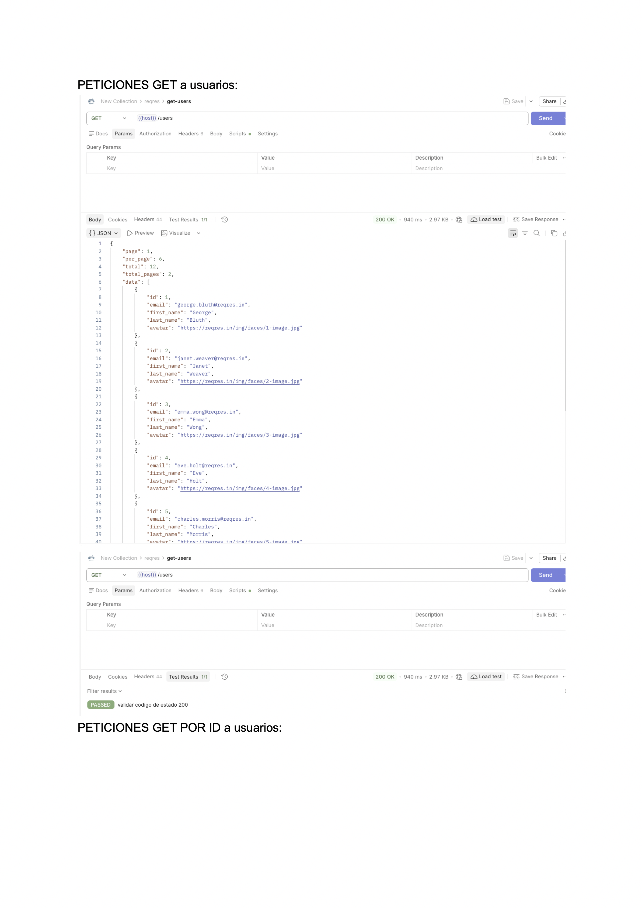
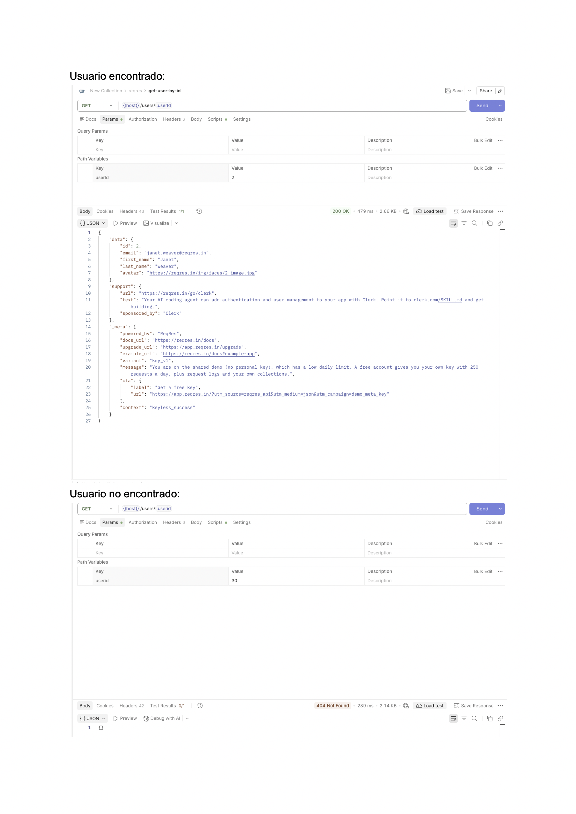
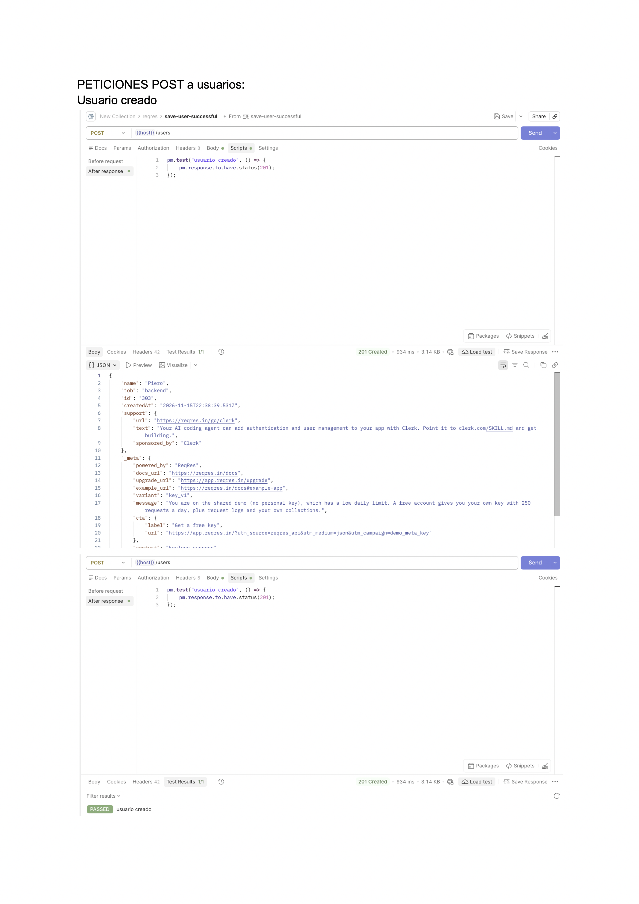
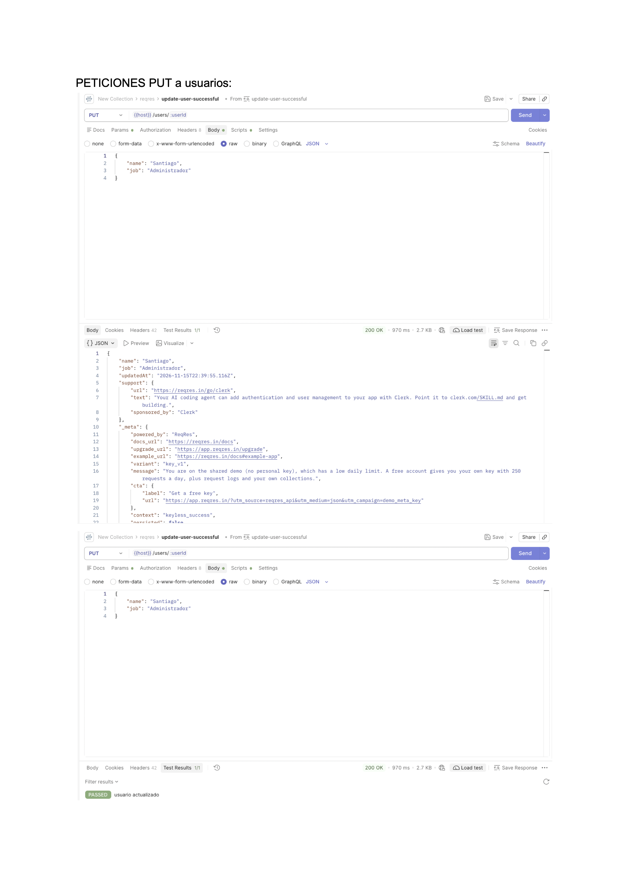
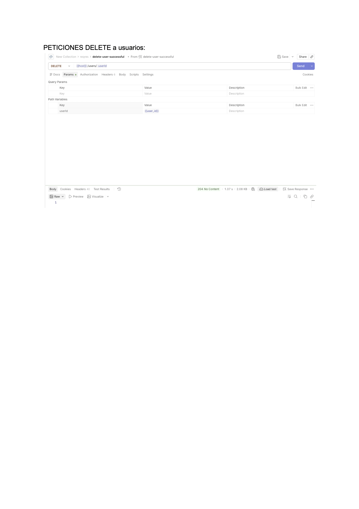

# Práctica Postman - API de usuarios

Colección de Postman para probar las operaciones CRUD de usuarios usando la API pública [ReqRes](https://reqres.in/).

## Contenido

- Listar usuarios.
- Consultar un usuario por ID.
- Crear un usuario.
- Actualizar un usuario.
- Eliminar un usuario.
- Validar los códigos de estado HTTP mediante pruebas automáticas de Postman.

## Requisitos

- [Postman](https://www.postman.com/downloads/) instalado.
- Acceso a Internet.

## Configuración

1. Importa [`practica-postman-ntt.postman_collection.json`](./practica-postman-ntt.postman_collection.json) en Postman.
2. Crea un environment y define la variable:

   | Variable | Valor |
   | --- | --- |
   | `host` | `https://reqres.in/api` |

3. Selecciona el environment antes de ejecutar las peticiones.

## Peticiones disponibles

Todas las peticiones pertenecen a la carpeta `reqres` y usan `{{host}}` como URL base.

| Operación | Método | Endpoint | Validación |
| --- | --- | --- | --- |
| Listar usuarios | `GET` | `/users` | Estado `200` |
| Consultar usuario | `GET` | `/users/:userId` | Estado `200` |
| Crear usuario | `POST` | `/users` | Estado `201` |
| Actualizar usuario | `PUT` | `/users/:userId` | Estado `200` |
| Eliminar usuario | `DELETE` | `/users/:userId` | Respuesta de eliminación |

### Crear usuario

La petición `POST /users` utiliza el siguiente cuerpo JSON:

```json
{
  "name": "123",
  "job": "asd"
}
```

La prueba guarda el `id` devuelto en la variable de environment `user_id`.

### Actualizar usuario

La petición `PUT /users/:userId` utiliza el siguiente cuerpo JSON:

```json
{
  "name": "Santiago",
  "job": "Administrador"
}
```

## Ejecución

1. Ejecuta `get-users` para consultar la lista.
2. Ejecuta `get-user-by-id` con un valor válido para `userId`.
3. Ejecuta `save-user` y conserva el `user_id` generado.
4. Ejecuta `update-user` usando el ID del usuario.
5. Ejecuta `delete-user` para eliminarlo.

Después de cada solicitud, revisa la pestaña **Test Results** para confirmar las validaciones automáticas.

## Evidencias

### Consultas GET





### Creación de usuario



### Actualización de usuario



### Eliminación de usuario


